Something that does not make me smile is homogeneity in car colors. Everything is monochrome when we could be having a rainbow of fun colors, and this is a trend that is continuing to worsen over time.

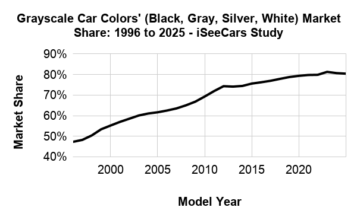

Yesterday, when I should have been packing for a trip to San Francisco (hi from my flight), I was thinking about this and came up with a few research questions I wanted to answer:

> Does distribution of car colors vary by geographic region?

> Does city size have any impact?

> What region has the most colorful cars?

My favorite part about being good at touching computers is I can find answers to just about any question if I put in enough effort. I did a tiny amount of research and couldn't find any great sources of prior art, but I didn't bother looking too hard since I find figuring things out on my own a lot more fun.

There are a few different ways to answer this, the most accurate would probably be to hunt down vehicle purchase/registration data published by state governments. That sounds like a lot of not very fun work, though, so I decided quickly not to do it. I didn't even look to see if those records are typically something made public.

The other idea I had, that I was much more excited about, was to use at satellite imagery of roads and parking lots. I've wanted to write software to do aerial image analysis for quite a while but never had a good excuse. This seemed as good as any.

The first big problem to solve was where I was going to get my image data in the first place. The ideal dataset is:
- High resolution
- Recently captured
- Sun synchronous (every image taken at the same time of day, regardless of location)
- Color
- Free

That last point limits my options significantly. I know the perfect data is out there, but it's not available unless you work for a three letter agency or want to pay up. I ended up using data from the USDA's [National Agriculture Imagery Program](https://catalog.data.gov/dataset/national-agriculture-imagery-program-naip-imagery). The NAIP dataset checks a surprising amount of my boxes. Most importantly: it's totally free to access, without even needing to register for any kind of account or API key. Thank you USDA!

Two main limitations of the NAIP data:
- Only available in the US. This is kind of a bummer because I'm really curious how this differs across the world.
- The highest resolution data is 30cm per pixel, and only available in some states. 

"30cm resolution" here means that 1 pixel of the output image equals 30cm of width on the ground.

Heres what that means in practice:

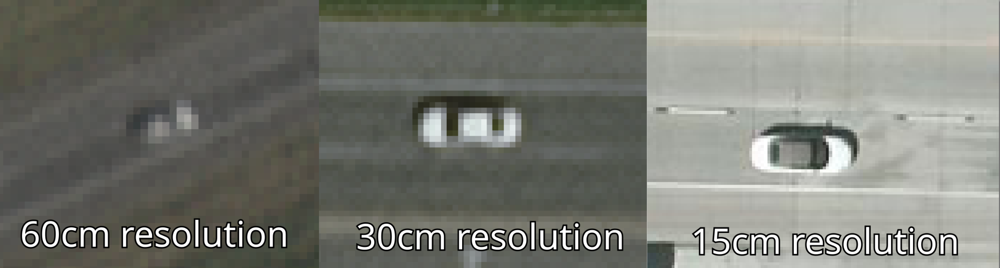

As much as I wish it was better, I'm very happy the 30cm data is available because anything lower would be pretty hard to tell the color of a car, if I could even reliably identify there was a car at all.

Iowa is one of the states with 30cm data available, so I decided to start with Des Moines. I could make up some reasons about why it makes a good test bed but in reality I chose it because I used to live there and that made looking at the data more fun.

I started downloading imagery of Des Moines and quickly faced another problem common to working with image data: it's *huge*. I downloaded one 45km2 image of the city and it was 1.6GB. I don't really want to spend hundreds of gigabytes of storage space and bandwidth per city to answer this question.

It turns out that there's actually a lot more to cities than just roads, highways, and parking lots.

To illustrate this, lets take a look at that 1.6GB tile:

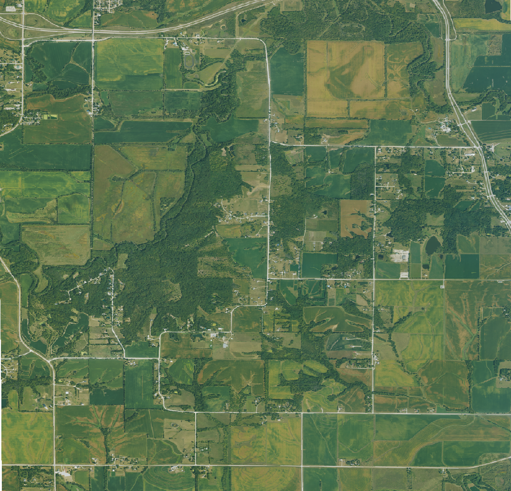

I could save a whole lot of space if I was able to just.. not download the parts of the image that aren't roads. Good thing I can do exactly that!

I exported OpenStreetMap data for all the roads and parking lots in Des Moines, and only asked for map tiles that contained or was close to a road.

Here's the new image with that filtering:

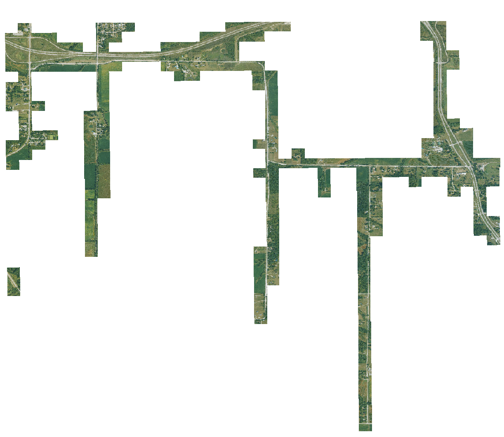

This new image is just 290MB, which is a lot more reasonable. When downloaded like this, the whole city only takes up 10GB. Still a lot of data, but a much more manageable amount.
## Detecting Cars
Before I can figure out what color a car is, I need to be able to tell where the cars are. This is one area where I did a bit of research on how other people have solved this problem, since it's a pretty straightforward and common task. Most of the work I found was using neural networks for this, which I didn't really want to use. 

It seemed like a simple enough task to figure out algorithmically: thanks to the OpenStreetMap data, I know exactly where all the roads are in my data. I can use that data to sample what each segment of road looks like. after all, roads are just a big blotch of solid colors. If I can tell what a road is, I can tell what a road isn't. A not-road where a road should be is a possible car. Easy!

It's not that easy.

The algorithm I ended up with sort of worked. It was able to pick out some cars.

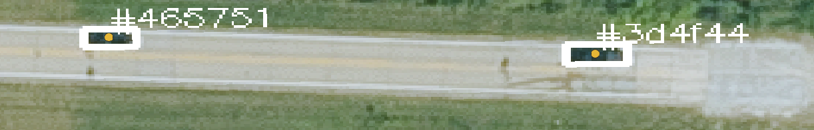

Good job algorithm! Unfortunately it very much did not work in the majority of cases. It very easily got fooled by shadows and trees:

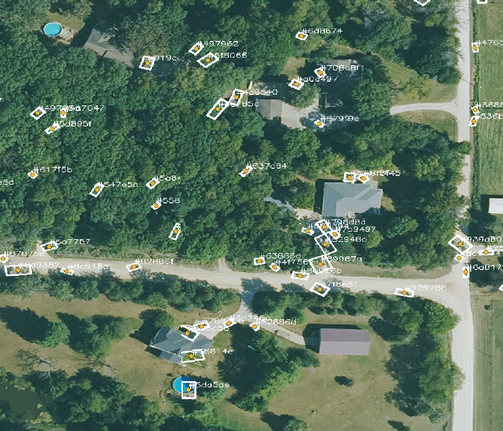

It also regularly missed cars even in ideal conditions:

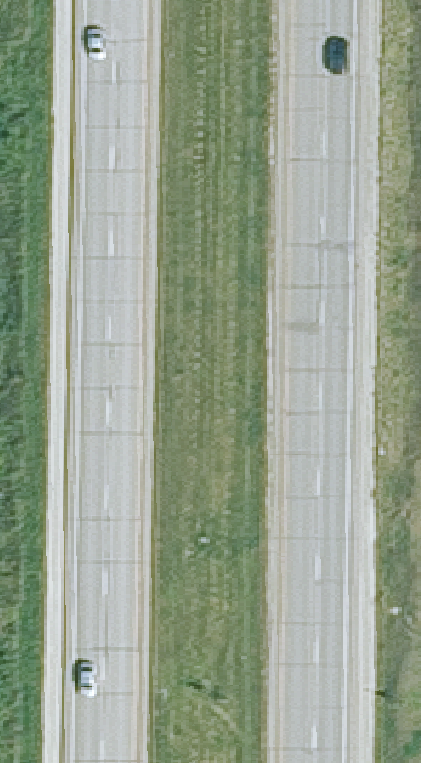

The final straw that made me ditch this approach was how bad this algorithm was at parking lots:

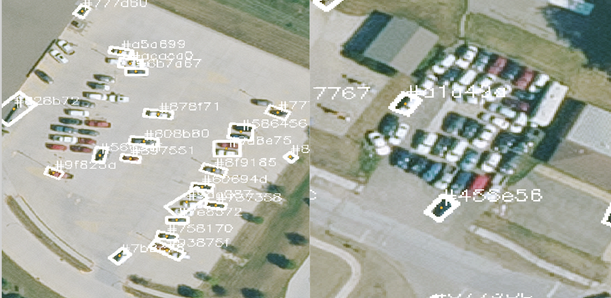

If I threw my head at it more, I'm sure I could have figured something out that was passable. Ultimately though this approach had flaws from the start because of how reliant it is on the OpenStreetMap road data. It's quite common for the OSM data to not line up perfectly with satellite imagery. With this algorithm, all it took was a small divergence to throw off all the calculations. OSM still makes a great starting point for where to look, but it can't be my oracle.
## The neural network
I guess all those people who tackled this problem with neural nets settled on them for a reason. I tried a couple pre-trained models for aerial car identification I found online but none of them worked very well as a drop in solution. I figured it would be easier (and more fun) to train my own model instead of trying to figure out how to make existing models work.

I do not know very much about machine learning, but I asked my friend who is very knowledgeable and she suggested training a YOLO model. I don't know what a YOLO model is or why it works so well for this use case but it was a very helpful suggestion, after only about 20 min of work I already had a model that was already working better than my original algorithm:

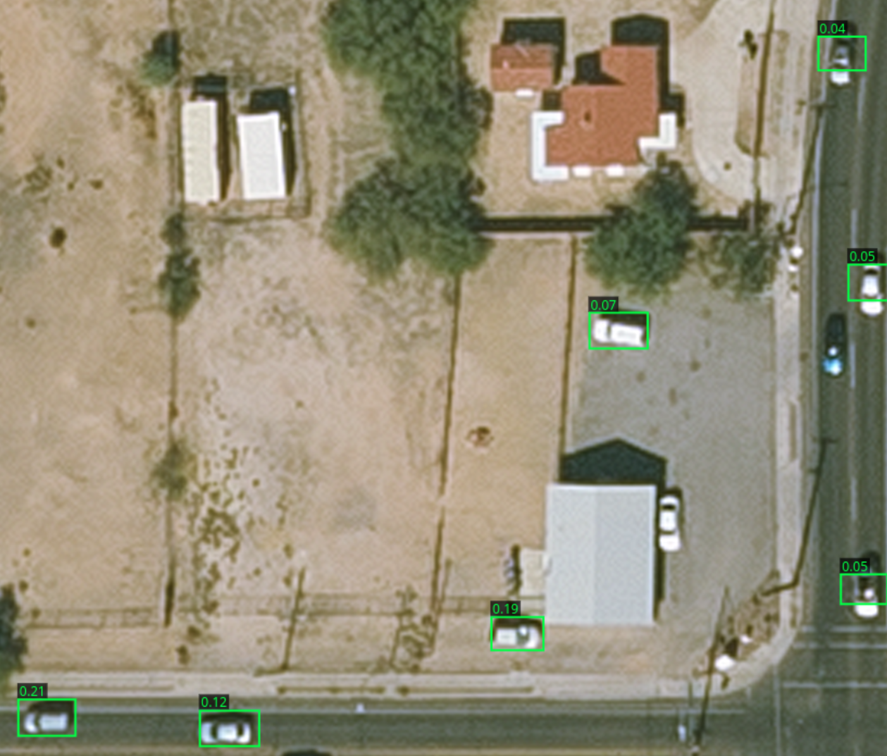

This was after about 5 minutes of training on my laptop (Framework 13 Pro) and from just 10 manually annotated images to use as training data.

Since the output from the model was already kind of usable, I used it to help me annotate more images. I would run an image through it, correct where it went wrong, and then pass that as new training data. This especially made tagging big parking lots MUCH faster, which would otherwise be a couple tedious minutes of drawing boxes over cars.

After a couple iterations of this process, the model got good enough I rarely had to make any changes, and annotating the data became a process of finding the right confidence threshold for a particular image to get all the cars without any false positives.

About halfway through training I added imagery from other cities in to the mix, which the model adapted to great.

I decided to stop once I hit 500 labeled images, and do an extra-long training run before doing the final analysis.

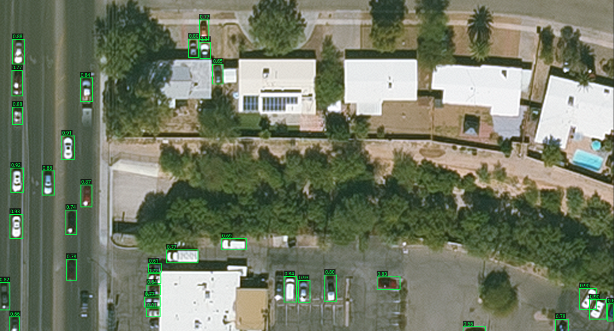

The final model still has its limitations: most notably it loves to pick up roof mounted satellite dishes and HVAC units. Ironically, I've also noticed it seems to be worse at colored cars. I think this is because they are less common and thus less represented in the training data.

## Color sampling
Another big limitation of the model is rotated cars. If a car is at an angle, the bounding box includes a lot of things that are not the car. I don't know enough about the YOLO architecture to say for sure if this is harming accuracy that much, but one thing it definitely harms is how easy it is to determine the color of a car. To mitigate this I decided to calculate a flood fill starting from the edges, which does an okay job getting rid of the corners in angled cars.

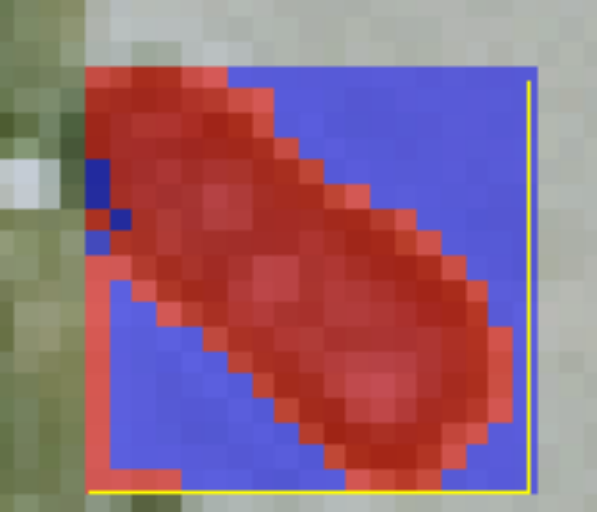

(blue= ignored pixels, red = included in mean)

## Results
Here are all 153,000 cars my model detected in Des Moines. 

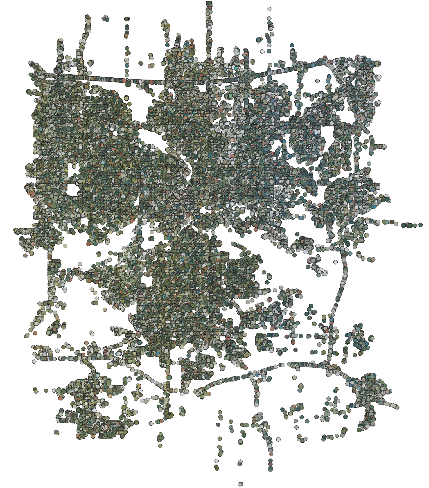

You can see just how much of the surrounding area bleeds into the image, the cars on the west side of the city (which has more trees) are reported as more green, whereas closer to downtown and the east side they are lighter and likely closer to the true color of the cars. 153,000 is also in the rough ballpark of how many cars I would expect to be in the city, so it's a good sanity check that the model isn't completely off base.

On to the color distribution:

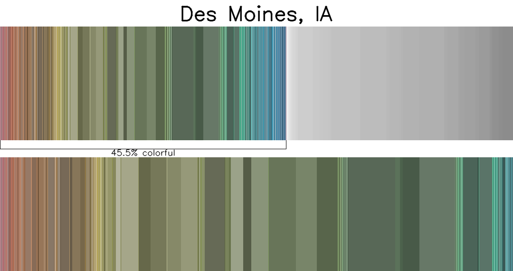

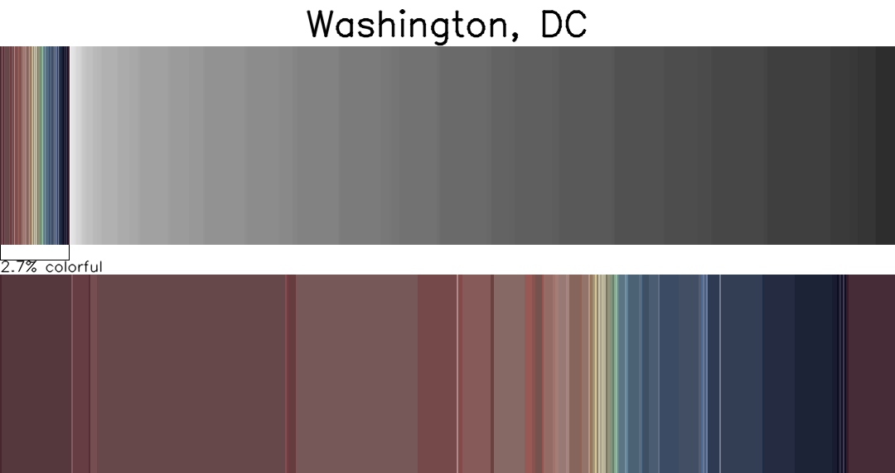

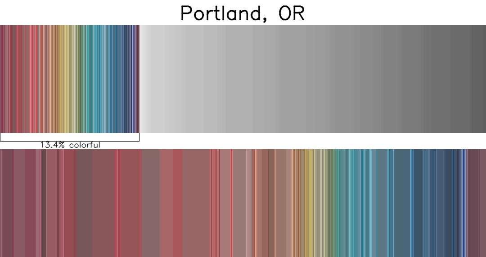

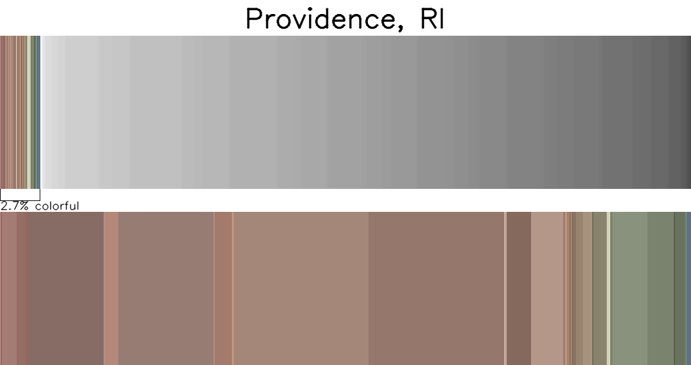

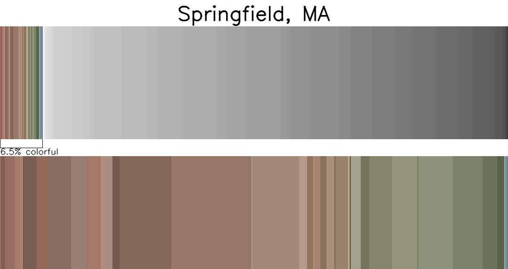

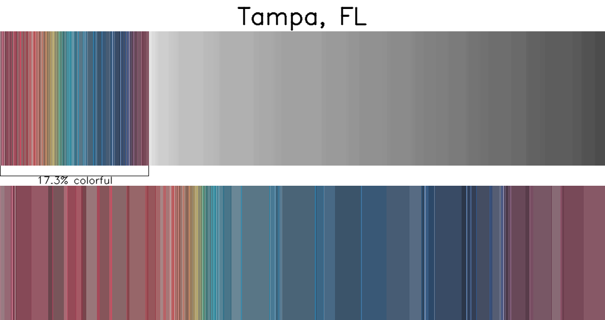

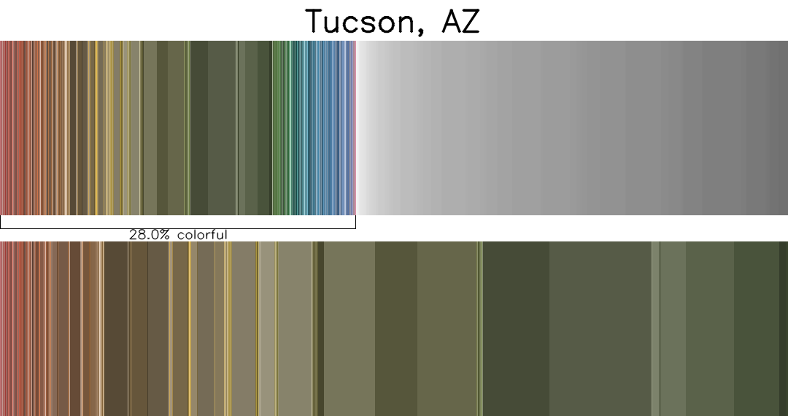

As muddy as the data is, its kind of close to the results in this [study](https://www.iseecars.com/most-popular-car-colors-study) stating the marketshare of non-greyscale cars is about 20%, and the most popular colors are red and blue.

The results for Portland and Tampa look the most similar to the results of the study, it's quite interesting how there are so few colored cars on the northeastern US. It's most likely an issue with my code or the model but I would believe that there are significantly less colorful cars in Washington DC because of so many black government vehicles. You can even sort of see that if you squint at the gradient.

One thing I noticed while annotating the Tucson data is that there are a lot of old cars in peoples lawn and junkyards. I think that explains the big band of rust and beige colored cars there.

To answer my original research question: yes, region has a difference. It's hard to tell how much based on this data alone though. I need to keep pushing on the eyeballs of the linear algebra to get a better answer.

## Future work

I didn't have as much time as I wanted to work on this before the arbitrary deadline I set for myself to write this blog post. There are a lot of things I would have done better should I have had more time, and may potentially expand on in the future if I care enough to do so.

I also did not have enough time to download all of the imagery I wanted before needing to leave for my flight, so large chunks of every city that isn't Des Moines is missing. This is an easy thing to fix the next time I have an internet connection that isn't a hotel or conference center. This is probably for the best since otherwise inference would have taken much longer and finishing this post already kept me up later than I wanted. 

I want to train a new model that can handle rotated boxes (YOLO supports oriented bounding boxes, I just decided not to use them for simplicity)

I also think I made a mistake by labeling partially occluded cars while training. My mindset while annotating was that if I could tell a car was somewhere, even if it was mostly context clues, to still label it as a car. Being okay with missing some cars and only tagging the ones that would make good samples to pick a color from will probably do a lot to improve accuracy of the final color detection.

It might also be worth making different models for different regions and/or contexts for cars. It might be helpful to have one really really good model for parking lots, and one really really good model for highways, for example.

I also think it would make for better analysis if I to applied some kind of color correction based on image source. I don't know how much of the variation I found is due to differences in the imagery, I suspect this is the case for the lack of colored cars in RI and MA. I don't know how I would calibrate this in any kind of formal or rigorous manner, though.

I also want to explore other data sources, particularly for cities outside of the US. Getting smaller amounts of data for more cities would also help me more substantially answer my research questions.