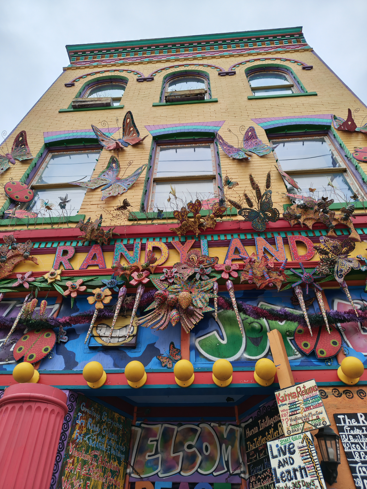
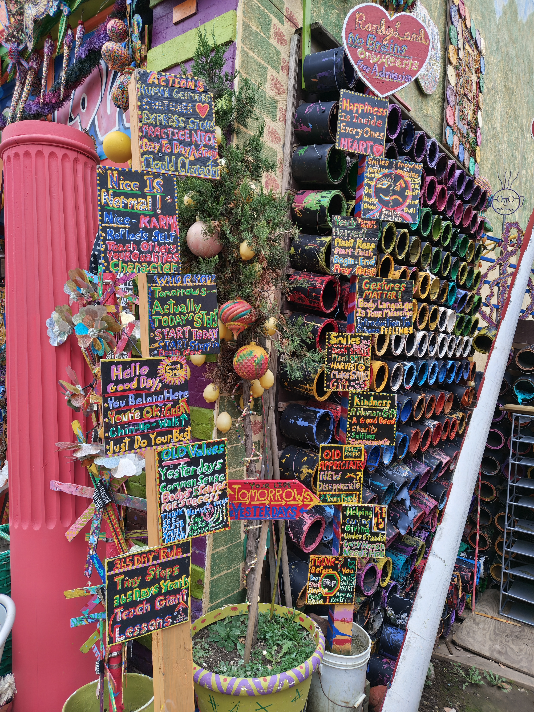
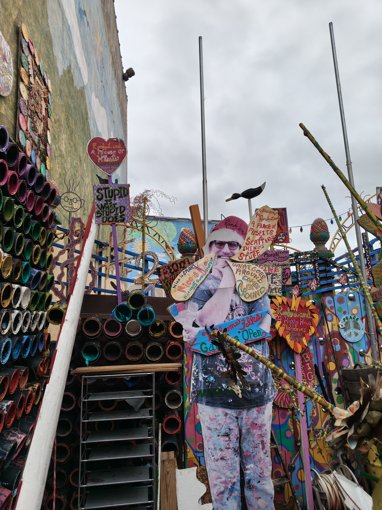

This week I was in Pittsburgh to speak at the [CAEL Conference](https://www.cael.org/cael-conference).

It was my second time in Pittsburgh, but the first time I had a couple hours to go out and do anything. 

I decided to visit an outdoor art museum called [Randyland](https://en.wikipedia.org/wiki/Randyland).[^1] Randyland is the creation of local Randy Gilson, and the Randyland museum is just one element of Randy's wider mission to uplift and rejuvenate the entire northside neighborhood. There's the Randyland museum itself, but also a sprawling network of community gardens, colorful sidewalks, and directional signs to help you find what the neighborhood has to offer.

I was so happy I chose to visit Randyland. The good vibes and positive karma was infectious and I couldn't stop myself from smiling all day after visiting. It was the catalyst for me exploring the Northside neighborhood all afternoon, which would have stretched into the evening had it not started raining. Thank you, Randy! I love you.

Randyland is free to visit and operates off of donations. If you visit, and have the means to donate, please do so.

Be like Randy, and spread joy relentlessly.

[^1]: I found out about Randyland on [Atlas Obscura](https://www.atlasobscura.com/), a map of unique and interesting things to see around the world. The first thing I do when I have time to explore in a city is check Atlas Obscura for what's nearby. There's almost always something cool within walking distance if you're in a major city.