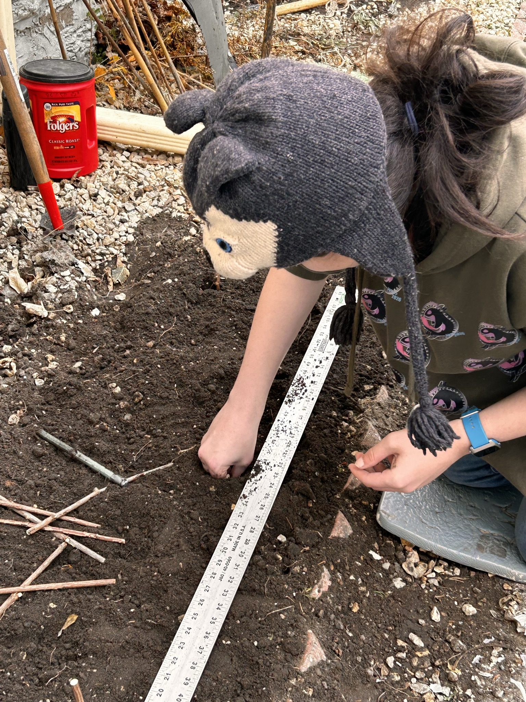
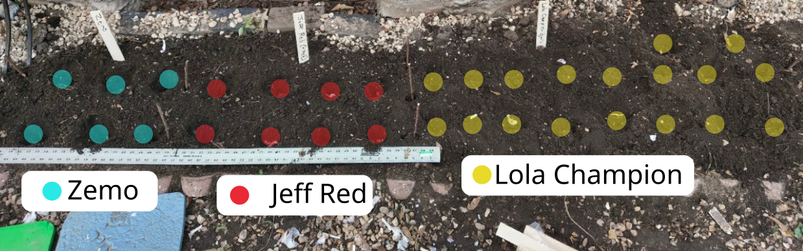
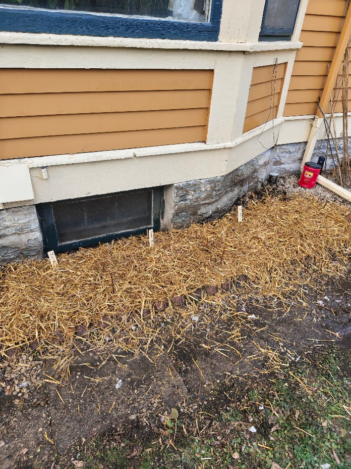

Today I planted some garlic!

I have been meaning to ever since I [went to the Minnesota Garlic Festival](/2026-08-16-garlic-festival.md) earlier this year. I thought I missed my window to plant it because I was procrastinating but apparently I didn't, according to my Jeff, my friend who is a garlic expert.

Yesterday, I dug up the [peppers I planted](/2026-06-14-planting) and started preparing the soil for planting. I got rid of as many roots as I could, rocks, and added some compost. In adding the compose, I learned a valuable lesson about not gardening during the dark - the compost had a bunch of twigs and fibers and such I couldn't see due to the low light so in the morning I realized I basically un-did all my work yesterday by adding the compost. 

After doing some more work to the soil I put the garlic cloves in the ground. Planting them was easy and quick and some of the cloves I planted were huge! Apparently the bigger the clove the bigger the head of garlic will be, which makes sense.

I had room for 32 garlic. I am very excited to announce the discovery of two **entirely new species** of garlic that are now growing in my garden!

The "Lola Champion" garlic is some garlic I bought from [Big Stone Garlic](https://www.bigstonegarlic.com/) at the garlic festival. I don't remember what variety it is but they said it was good garlic for a beginner. It sat on my kitchen table for several months and was half eaten by the time I planted it which is why I am confident in this being a new species since sitting in the kitchen helped with evolutionary divergence. 

The "Jeff Red" garlic was in the same pile of garlic sitting on my kitchen table. It's a mixed set of red garlic and we don't know which species. We planted the 8 largest cloves. So another new species, probably - this botany thing is easy!

Lastly I planted Zemo garlic. Jeff brought this over and was raving about how good it was. It's from the Republic of Georgia and the internet says it's great during cold winters so probably a great one to plant here in Minnesota. 

After putting the cloves in the ground we covered the bed in straw to insulate it. Straw is apparently the best insulator because other options (leaves, mulch) are harder for the stems to break through in the spring.

Hopefully I get some good garlic in the spring! Big thank you to Jeff for the help and push I needed to get this done. 