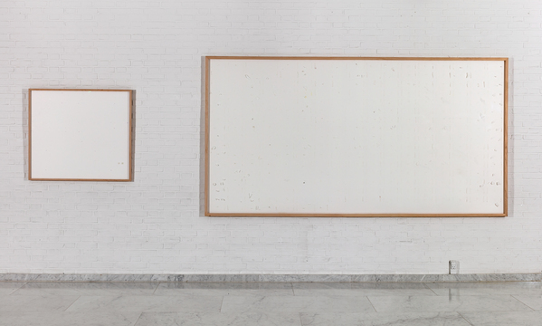
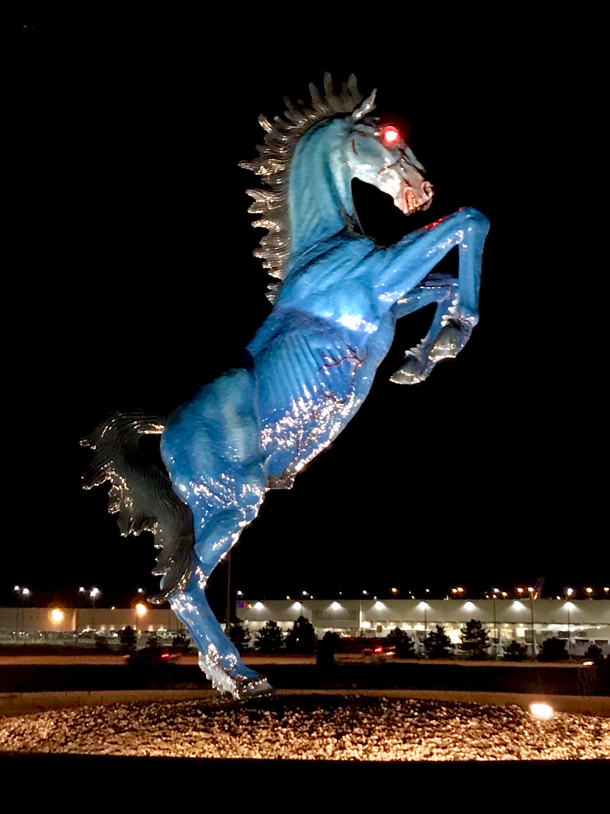

---
tags:
  - creativity
date: 2026-11-03T22:33:00
layout: post
---

Last week, I attended a great talk from Qianqian Ye, the Director of Creative Technology at the Processing Foundation. The Processing Foundation is primarily known for [p5.js](https://p5js.org/), a tool focused on creative coding. p5.js has millions of users and has been used to create art on display in the MoMA.

The talk opens with Q sharing the story behind a piece they made, [Becoming a Mother at the End of The world](https://qianqian-ye.com/becoming-a-mother-at-the-end-of-the-world/). Hearing her share the details of their creative process, the emotion behind the work, and my empathy with the internal conflict the art represents made me cry. I strongly encourage you to [watch the talk in full](https://www.youtube.com/watch?v=dcLy_Tq8LO4), it's one of the best I've been to this year.

## What is art?
Just a few days before hearing Q's talk, I was part of an extended discussion about to what extent generative AI output can be considered "art."[^1]

Conceptually, art is a union of two distinct ideas: art, the process, and art, the result. 

Colloquially, when we use the word art, we mean art (the result) and not art (the process) or art (the concept). Conversations about "what is art" are further muddied by art being so deeply personal and contextual. Just because you personally don't find meaning in a work of art does not disqualify it from the classification of art, or devalue others' opinion. 

A work of art is an extension of the artists humanity, shaped by their intent, emotion, and lived experience. Appreciating art means noticing the emotions it invokes. For something to not be art, it must be devoid of intention, meaning, and feelings. To say "this is not art" is to say "there is nothing contained within this that represents what makes us human." The art community has a word for this: *kitsch*. Declaration of a creation as kitsch is one of the harshest insults you can give a creative work.

Qianqian is open about using LLM coding tools for some of their work. She has undeniably created art. Its possible for generative AI tools to be used to create art, but they must be piloted with intent and used as a tool that does not replace human creativity.

## Art is story
Consider the piece below:

Take a moment to stop reading and think about how this makes you feel. Is it art? Why or why not? 

 
 
 
 

This is a work by Danish artist Jens Haaning titled _Take the Money and Run_. 

In 2021, Jens was commissioned by a museum in Denmark to make artwork out of kroner bills. Jens chose to keep the bills and gave the museum these two canvases.

After hearing this story, how did your feelings change? 

I find this work fascinating because displaying a blank canvas in a museum I do not think is art. Displaying _these blank canvases specifically_ it becomes art. 

---

My personal favorite piece of art is this sculpture outside the Denver airport:

I just love this thing. 

This sculpture is named Blue Mustang, although it's more commonly known as Blucifer. It's most well known for killing the artist who sculpted it. It was ultimately finished by the artists family to avoid breach of contract with the state government, who commissioned the sculpture.

I like this sculpture for a lot of reasons. For one, I love the way it looks - there's something about the shade of blue next to the glowing red eyes I just love. I also find an element of mystique and power to the fact I'm looking at a sculpture that took someone's life. To me, that elevates this from something that I think looks kind of cool to my favorite piece of art. To me, nothing better represents the human desire to create than putting so much of yourself into something that it kills you to do it.

## Code is a medium
You can use code to create work we traditionally associate with art, like a images or music. I argue code itself has the potential to be art, too.

A few years ago, I was mentoring a student at a CodeDay event in Seattle. They were making a website. I don't remember what the website was for, but I remember there was a text input box. The student was testing their website, and tried to press the enter key on the keyboard instead of clicking confirm. It didn't work.

At that moment, the most important thing to the student became adding that functionality. In that same moment, their project became more than just software, and became art. They had a clear vision for what they wanted, the thing they had wasn't that, and they would move a mountain to realize their vision.

Wanting to have a functional enter button isn't exactly a creative innovation. It doesn't have to be to still be art. Art is about the story, the process, and being human. Humans care about the little things. Humans have passion, motivation, and desire. None of those can emerge if you don't care about what you're doing.

Problem solving through code creates stories, and stories create art. Even if that art is a couple lines of code that make the enter button work on your website. 

A great example of the new dimensions code opens for creative work is the artist [tom7](http://tom7.org). Tom makes all kinds of wacky stuff with computers. I especially like his project [NaN Gates and Flip FLOPS](https://www.youtube.com/watch?v=5TFDG-y-EHs).

Spoilers: the punchline to this video is Tom makes a computer that runs entirely on floating point numbers. There's no display or indicators of what it's doing, you just plug it in and appreciate the fact you know how it works.

**Go make art, and make something uniquely you**.

It doesn't matter how you make it, just that it exists.

---
[^1]: This is a nuanced issue and an in-depth exploration of my take is out of scope for this post. I have mixed feelings on generative AI tools, and am broadly negative when it comes to image generation and unauthorized training + reproduction of artists' work.
